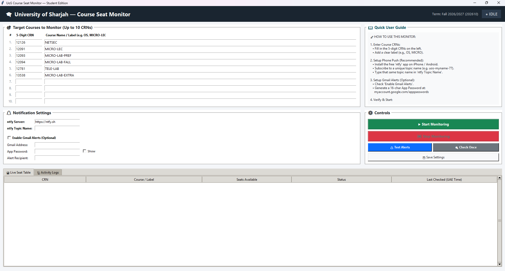

# UoS Course Seat Monitor (University of Sharjah)

> **Instant notifications when seats open in required UoS classes.**  
> Phone Alerts (iOS & Android) • Windows Desktop Popups • Email Alerts • 100% password-free public class browsing.

[-2ea44f?style=for-the-badge&logo=windows)](https://github.com/IamOumarIbrahim/class-watcher-uos/releases/download/v1.0.0/UoS-Course-Seat-Monitor-Setup.exe)  
**Direct Download:** [**UoS-Course-Seat-Monitor-Setup.exe (12.9 MB)**](https://github.com/IamOumarIbrahim/class-watcher-uos/releases/download/v1.0.0/UoS-Course-Seat-Monitor-Setup.exe)

<p align="center">
  
</p>

## Setup & Usage

1. Run the installer and open **UoS Course Seat Monitor**.
2. Enter the 5-digit Course Reference Numbers (CRNs) to watch.
3. Enter a private **ntfy Topic Name** for phone notifications.
4. Click **Test Alerts**, then click **Start Monitoring**.

### Phone Alerts (ntfy)
1. Install the free **ntfy** app ([iOS](https://apps.apple.com/us/app/ntfy/id1625396347) / [Android](https://play.google.com/store/apps/details?id=io.heckel.ntfy)).
2. Tap **+ (Add Topic)** and enter a custom topic name (e.g., `uos-alerts-yourname`).
3. Enter that exact topic name in the app and test alerts.

## FAQ

- **What is a CRN?** The 5-digit Course Reference Number from the UoS Banner registration schedule.
- **Is my university password required?** No. The tool monitors public schedule availability without credentials.
- **Does it automatically register the seat?** No. Automated bot registration is prohibited. It notifies you immediately so you can register manually.
- **Does my computer need to stay on?** Yes. The background loop polls every 30 seconds; keep your machine active and connected.

## Run from Source

```powershell
git clone https://github.com/IamOumarIbrahim/class-watcher-uos.git
cd class-watcher-uos/uos-seat-monitor
.\install.ps1
.\run_gui.ps1
```

## Help the project

Did this help you? Please give it a **star**, so more people can find it. Bugs and ideas are welcome in [Issues](https://github.com/IamOumarIbrahim/class-watcher-uos/issues).

## License

[MIT](LICENSE)
